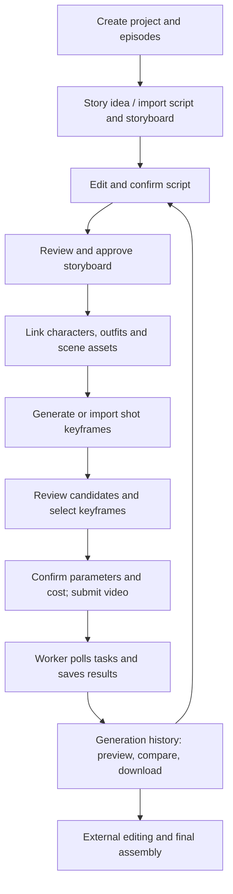

# AI Drama Studio

**English** | [简体中文](README.zh-CN.md)

An AI short-drama production platform organized around individual shots. It connects story and script review, character and scene assets, storyboards, keyframes, video tasks, and generation history in a workflow that can be traced and revised.

Maintained independently in `David-the-happy-piglet/AI-drama-studio`, with `main` as the default branch. The WeChat article system lives in [wechat-cg](https://github.com/David-the-happy-piglet/wechat-cg).

## Production workflow



| Stage | Operator and system interaction | Saved output |
| --- | --- | --- |
| Project and story | Create projects and episodes; write manually, import storyboards, or plan with a configured text model | Episodes, script drafts, storyboard review drafts |
| Storyboard review and approval | Edit the script and shot descriptions, confirm the script, then approve the storyboard | Episode → Scene → Shot |
| Consistency assets | Upload character master images, outfits, and scene references; explicitly confirm remote subject registration when needed | Local assets, associations, image fingerprints |
| Keyframes | Generate candidates or import images from a conversation; select manually, or let a batch adopt the first candidate | Candidate images and the selected keyframe version |
| Video production | Validate model capabilities, assets, duration, and costs; confirm single-shot or batch submission | Separate Generation attempts and external task IDs |
| Review and delivery | Query results, compare history, download selected clips, and assemble them in external editing software | Videos and snapshots of generation inputs |

### Three production paths

1. **One shot at a time.** Review the keyframe, then confirm the video call. Use this when shots need individual control.
2. **Separate batch stages.** Generate keyframes in a batch, then independently confirm batch video submission.
3. **Keyframe → video workflow.** One confirmation authorizes both stages. Each shot advances once its keyframe is ready, without waiting for the entire batch. Changes to shot or asset versions block subsequent submission.

The batch worker uses persistent jobs and database leases, so it can continue after the browser closes. Timeouts or uncertain results do not automatically trigger another paid submission; the remote state must be checked. Batch videos are marked ready only after downloading and recording verification metadata. Individual manually submitted tasks are refreshed from the history page.

### Revision and traceability

Each generation independently records prompts, reference inputs, model, parameters, shot version, external task ID, status, and output without overwriting earlier results. Approved storyboards can be withdrawn for revision. Shots with stable IDs retain associations and history, while stale assets are flagged for review. Character and scene master assets can be reused, but the system does not claim to solve all continuity problems across shots automatically.

## Engineering structure

```text
ai-drama-studio/
├── frontend/              # React + TypeScript + Vite production UI
├── backend/
│   ├── app/api/           # REST endpoints
│   ├── app/services/      # Script review, assets, keyframes, generations and batches
│   ├── app/providers/     # Text, image and video adapter boundaries
│   ├── app/models/        # Projects, episodes, scenes, shots and generation records
│   ├── app/batch_worker.py
│   ├── migrations/        # Alembic database migrations
│   └── tests/
├── config/providers/      # Non-secret provider configuration
├── docs/                  # Architecture and workflow handoff guides
├── .env.example
└── docker-compose.yml
```

The backend uses FastAPI and SQLAlchemy. Local development defaults to SQLite; Compose uses PostgreSQL. Implemented adapters include mock, Seedance, Kling, and MiniMax. Available modes depend on application preflight checks and the actual account's permissions. Credentials are loaded only by the backend.

## Run locally without API keys

```bash
git clone https://github.com/David-the-happy-piglet/AI-drama-studio.git
cd AI-drama-studio/ai-drama-studio
python3 -m venv .venv
source .venv/bin/activate
pip install -r backend/requirements-dev.txt
cd backend
alembic upgrade head
uvicorn app.main:app --reload --host 127.0.0.1 --port 8100
```

In a second terminal, start from the cloned repository root:

```bash
source ai-drama-studio/.venv/bin/activate
cd ai-drama-studio/backend
python -m app.batch_worker
```

In a third terminal, start from the cloned repository root:

```bash
cd ai-drama-studio/frontend
npm ci
npm run dev
```

Open the [production UI](http://localhost:3000) and [API documentation](http://localhost:8100/docs). Without credentials, you can manually create projects and storyboards and use the API's mock provider to validate generation and history. The production UI focuses on real providers. Real generation requires backend provider configuration and confirmation in the UI. A provider CLI installation or login is not required to start the local studio.

For containers, enter `ai-drama-studio`, copy `.env.example` to `.env`, and run `docker compose up --build`. See the [operations guide](ai-drama-studio/README.md) for service ports and configuration.

## Validation

From the cloned repository root:

```bash
cd ai-drama-studio/backend
../.venv/bin/python -m pytest
../.venv/bin/python -m ruff check app tests migrations
cd ../frontend
npm test
npm run build
```

CI validates the backend, frontend, migrations against an empty database, and Compose configuration. Tests use simulated providers and do not submit real paid tasks.

## Documentation and current boundaries

The detailed guides below are currently written in Chinese:

- [Operations and provider configuration](ai-drama-studio/README.md)
- [Architecture](ai-drama-studio/docs/ARCHITECTURE.md)
- [Claude / external storyboard handoff](ai-drama-studio/docs/CLAUDE_STORYBOARD_HANDOFF.md)
- [Conversation-generated images and batch import](ai-drama-studio/docs/CONVERSATION_IMAGE_BATCHES.md)
- [Database migrations](ai-drama-studio/backend/migrations/README.md)

The current application does not include a full editing timeline, automatic episode assembly, TTS, or fully automated continuity review. Final editing happens in external software. `data/`, local databases, backups, credentials, and generated outputs are excluded from Git; cloning does not include the developer's production projects.

## Project origins

This project was split from the `AI-drama-studio` branch of `Ctwqk/ContentGenerator`. Source history and original commit authors are preserved; ongoing development is maintained independently here.
