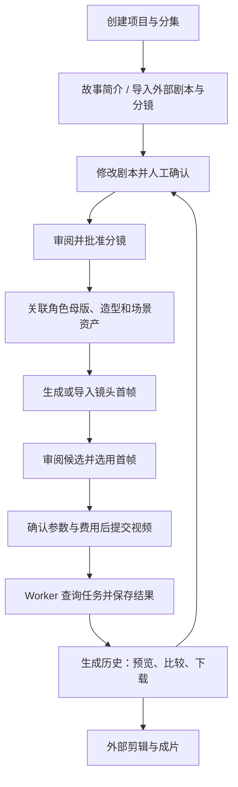

# AI Drama Studio

[English](README.md) | **简体中文**

以镜头为单位的 AI 短剧制作平台：从故事与剧本审阅，到角色/场景资产、分镜、首帧、视频任务和生成历史，把制作过程组织为可追踪、可修订的 workflow。

独立仓库：`David-the-happy-piglet/AI-drama-studio`，默认分支为 `main`。公众号文章系统见 [wechat-cg 仓库](https://github.com/David-the-happy-piglet/wechat-cg)。

## 制作工作流



| 阶段 | 操作者与系统如何协作 | 保存的产物 |
| --- | --- | --- |
| 项目与故事 | 新建项目/分集；手写、导入外部分镜，或使用配置的文本模型规划 | 分集、剧本草稿、分镜审阅稿 |
| 审阅与发布分镜 | 修改原文与逐镜头描述，确认剧本后批准分镜 | Episode → Scene → Shot |
| 一致性资产 | 上传角色母版、造型、场景参考；按需确认同步远端主体 | 本地资产、关联、图片指纹 |
| 首帧 | 生成候选或导入对话生图结果，人工选择；批处理可自动采用第一张候选 | 首帧候选与当前选用版本 |
| 视频制作 | 预检模型能力、素材、时长和费用；确认后逐镜或批量提交 | 独立 Generation 尝试及外部任务 ID |
| 复核与交付 | 查询结果、比较历史、下载满意片段，交由外部剪辑软件合成 | 视频与调用输入快照 |

### 三种制作路径

1. **逐镜制作**：先审首帧，再确认视频调用。适合需要逐项调控的镜头。
2. **分阶段批量制作**：批量生成首帧后，再独立确认批量视频提交。
3. **首帧 → 视频工作流**：一次确认授权两个阶段；每个镜头在首帧就绪后独立推进，不必等待整批。镜头或资产版本变化会拦截后续提交。

批量 worker 使用持久化任务与数据库租约，关闭浏览器后仍可运行。已发送请求出现超时或不确定结果时不会自动重复提交付费生成；需要核对远端状态。批量视频只有下载并记录校验信息后才标记 ready；单条人工任务在历史页手动刷新。

### 修订与可追溯性

每次生成独立保存 prompt、参考输入、模型、参数、镜头版本、外部任务 ID、状态和输出，不覆盖旧结果。已批准分镜可撤回修订，稳定 ID 的镜头保留关联与历史；失效素材提示复核。角色母版与场景母版支持复用，但不承诺自动解决所有跨镜头连续性问题。

## 工程组成

```text
ai-drama-studio/
├── frontend/              # React + TypeScript + Vite 制作台
├── backend/
│   ├── app/api/           # REST 接口
│   ├── app/services/      # 剧本审阅、资产、首帧、生成、批次协调
│   ├── app/providers/     # 文本/图片/视频适配边界
│   ├── app/models/        # 项目、分集、场景、镜头与生成记录
│   ├── app/batch_worker.py
│   ├── migrations/       # Alembic 数据库迁移
│   └── tests/
├── config/providers/      # 非敏感 provider 配置
├── docs/                  # 架构与工作流交接文档
├── .env.example
└── docker-compose.yml
```

后端为 FastAPI + SQLAlchemy；本地默认 SQLite，Compose 使用 PostgreSQL。支持 mock，以及 Seedance、Kling、MiniMax 对应的已实现适配器；可用模式以应用预检和实际账号权限为准。密钥只在后端加载。

## 无密钥本地启动

```bash
git clone https://github.com/David-the-happy-piglet/AI-drama-studio.git
cd AI-drama-studio/ai-drama-studio
python3 -m venv .venv
source .venv/bin/activate
pip install -r backend/requirements-dev.txt
cd backend
alembic upgrade head
uvicorn app.main:app --reload --host 127.0.0.1 --port 8100
```

在第二个终端，从 clone 后的仓库根目录运行：

```bash
source ai-drama-studio/.venv/bin/activate
cd ai-drama-studio/backend
python -m app.batch_worker
```

在第三个终端，从 clone 后的仓库根目录运行：

```bash
cd ai-drama-studio/frontend
npm ci
npm run dev
```

访问 [制作台](http://localhost:3000) 和 [API 文档](http://localhost:8100/docs)。无密钥时可手工建立项目与分镜，通过 API 的 mock provider 验证生成与历史流程（制作界面聚焦真实平台）。真实生成需要后端 provider 配置及界面确认；无需先安装或登录视频厂商 CLI 来启动本地制作台。

容器方式：进入 `ai-drama-studio`，复制 `.env.example` 为 `.env`，执行 `docker compose up --build`。各服务端口与配置见 [运行指南](ai-drama-studio/README.md)。

## 验证

```bash
cd ai-drama-studio/backend
../.venv/bin/python -m pytest
../.venv/bin/python -m ruff check app tests migrations
cd ../frontend
npm test
npm run build
```

CI 分别验证后端、前端、空库迁移与 Compose。测试使用模拟 provider，不提交真实付费任务。

## 文档与边界

- [运行与 provider 配置](ai-drama-studio/README.md)
- [架构设计](ai-drama-studio/docs/ARCHITECTURE.md)
- [Claude / 外部分镜交接](ai-drama-studio/docs/CLAUDE_STORYBOARD_HANDOFF.md)
- [对话生图与批量入库](ai-drama-studio/docs/CONVERSATION_IMAGE_BATCHES.md)
- [数据库迁移](ai-drama-studio/backend/migrations/README.md)

当前不包含完整时间线剪辑、自动整集合成、TTS 或全自动连续性审查；成片剪辑在外部工具完成。`data/`、本地数据库、备份、密钥和生成产物不提交 Git，clone 后不会包含开发者的制作项目。

本项目从 `Ctwqk/ContentGenerator` 的 `AI-drama-studio` 分支拆分，保留来源历史与原始提交作者；后续在本仓库独立维护。
